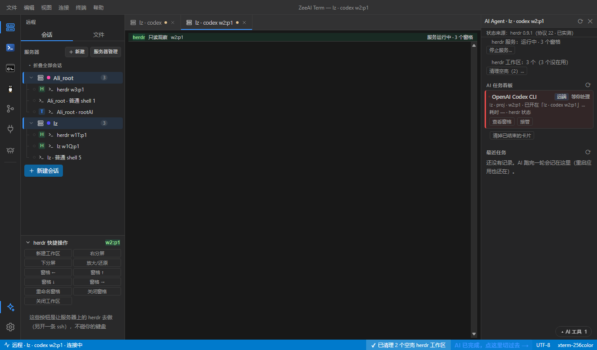
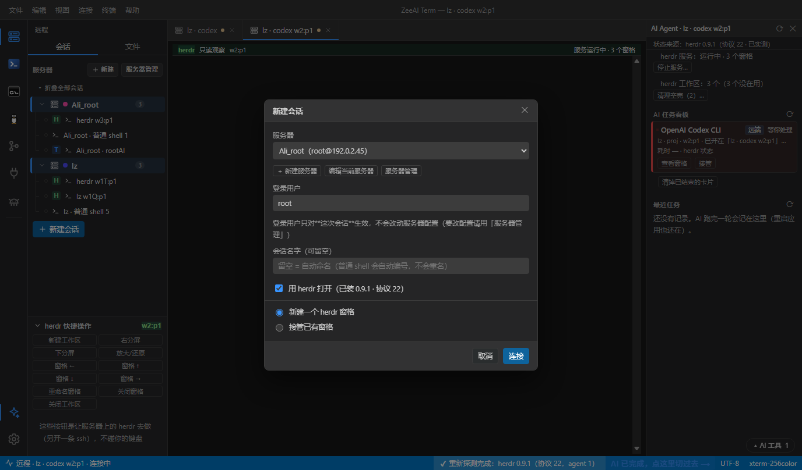

<div align="center">

# ZeeAI Term

**Windows / macOS 多协议终端工作台**
一台机器管住 SSH / tmux / herdr、串口、ADB、本地终端，还有一块 AI 任务看板。

[](#下载)
[](https://github.com/zeelinkCN/ZeeAI_Term/releases/latest)
[](#技术栈)
[](#许可证)



</div>

---

## 它是什么

给同时要摸好几台机器的人用的终端工具：**远端**连着服务器（SSH + tmux/herdr 持久会话、SFTP 文件、AI 在跑什么一目了然），**本地**在 Windows 开 PowerShell / CMD / WSL，在 macOS 开 zsh / bash，**手边**还挂着串口和 ADB 设备。

使用 tmux / herdr 的会话可**留在服务器上**，下次打开继续接入；远端文件能在应用里预览、下载；AI 状态把需要批准、回答和登录的会话优先放到眼前。关键字高亮只影响界面，**落盘的日志永远是纯文本**。

<div align="center">

</div>

## 功能一览

| | |
|---|---|
| **远端连接** | SSH（密钥 / 密码，复用系统 OpenSSH）、跳板机、断线指数退避重连 |
| **持久会话** | tmux 与 **herdr** 两种多路复用器，可接管可只读观察；关掉标签，会话仍留在服务器上 |
| **herdr 专治"忘了关"** | 侧栏 `H` 标 + 终端上方状态条；服务器右键可管理工作区（接管 / 观察 / 回收）；只清理"空壳" |
| **远端文件** | 真 SFTP：浏览 / 上传（多选、目录递归）/ 下载（断点续传）/ 重命名 / 删除；MD、HTML、图片、代码直接预览 |
| **本地终端** | Windows：PowerShell 5.1 / PowerShell 7 / CMD / WSL，可单开管理员窗口或整个应用提权；macOS：zsh / bash 登录 shell |
| **设备侧** | 串口（每条连接独立参数）、ADB logcat + 文件管理 + Fastboot 设备探测（看设备与版本，**不刷机**；Windows 内置 platform-tools，macOS 使用已安装的 Android Platform Tools） |
| **Git** | 打开本地仓库、暂存 / 提交 / 历史与 diff / 分支切换；每个工作空间可单独开终端 |
| **AI 状态** | 观察 ZeeAI 内的远端 Claude Code / Codex 会话：等待批准、回答、登录优先显示；本轮完成折叠；提醒按状态变化去重。普通 SSH 接收 OSC 7501，herdr 每分钟只查询已打开窗格；断线不误报完成 |
| **连接诊断** | 编辑服务器或连接失败提示里点「连接诊断」：只读跑一次 `ssh -G`，显示**实际生效的**主机 / 端口 / 用户 / 每个候选密钥是否存在 / 跳板机，并给一句人话结论 |
| **观感** | 14 套界面主题 + 15 套终端配色（可粘贴 Windows Terminal 配色 JSON）、四种分屏、侧栏可拖宽、`Ctrl+滚轮` 随手缩放字号 |
| **留档** | 终端日志（剥掉颜色转义，记事本可读）、关键字高亮（仅界面生效）、回滚行数可调 |
| **启动** | 深色底 + 静态启动屏（不闪白、不重影），扫描 / 快照 / WebGL 挂载一律等首帧之后 |

## 下载

到 [**Releases**](https://github.com/zeelinkCN/ZeeAI_Term/releases/latest) 下载 **0.1.15**：

| 产物 | 适合谁 |
|---|---|
| `ZeeAI_Term_0.1.15_x64-setup.exe` | Windows：双击安装，带开始菜单与卸载 |
| `ZeeAI_Term_0.1.15_x64_en-US.msi` | Windows：需要走组策略 / 批量部署 |
| `ZeeAI_Term-0.1.15-windows-x64-portable.zip` | Windows：不想安装，解压即用，**内含 platform-tools** |
| `ZeeAI_Term.exe` | Windows：已经有安装目录，只替换主程序 |
| `ZeeAI_Term_0.1.15_universal.dmg` | macOS：Apple Silicon 与 Intel 通用安装包 |
| `SHA256SUMS` | 校验下载文件 |

> 便携版：解压后 `resources/` 目录**必须和 exe 放在一起**（ADB 在里面）。
> 便携版**没有**应用内一键升级（没有安装目录可写）：换新版就下载新 zip、解压覆盖，
> 覆盖前先关掉正在跑的窗口即可。安装版 / MSI 版可以在应用内「设置 → 检查更新」一键升级；
> 下载一律做大小 + 文件头 + 官方 sha256 三重校验。

**系统要求**：Windows 10 / 11（x64）。需要 WebView2 运行时 —— Win11 自带，安装包会处理。

macOS 要求 **13.3 或更高版本**。Universal DMG 同时兼容 Apple Silicon 与 Intel。当前使用 ad-hoc 签名，尚无 Apple Developer ID 签名与公证；系统可能要求在「系统设置 → 隐私与安全性」允许打开已下载的应用。

Windows 与 Mac 共用更新检查地址，但分别选择当前系统和 CPU 对应的安装包。macOS 打开 DMG 后将应用拖进 Applications，更新时退出旧版并替换应用。应用设置和服务器列表保存在用户目录，替换应用后仍保留。

## AI 状态观察

打开远端终端运行 Claude Code 或 Codex，再点左侧星号。需要你处理的会话位于最上方，可直接切回原终端批准、回答或登录；收起面板仍会观察，关闭会话后停止。默认以数字和状态栏提醒；每轮完成提醒、Windows 任务栏 / Mac Dock 提醒可在面板设置中开启。

普通 SSH 使用 CLI 主动上报的 OSC 7501，支持 Claude Code 2.1.295+、Codex CLI 0.163.0+。herdr 使用服务端状态识别，每个已连接账户最短 60 秒查询一次，只显示 ZeeAI 当前打开的窗格。tmux 是否透传协议取决于版本；没有状态会显示「待确认」，不会按输出安静推测完成。不扫描外部终端、不读取 AI 对话日志，也不改写远端 CLI 配置。

## 开发

```powershell
npm ci                # Node.js 22.18+、Rust stable；Windows 还需要 MSVC，Mac 需要 Xcode Command Line Tools
npm run tauri dev      # 开发模式（热更新）
npm run tauri build    # 出 exe + NSIS + MSI
```

macOS 同样运行 `npm run tauri dev` / `npm run tauri build`，会自动使用 macOS 配置并生成 `.app` / `.dmg`，不会打入 Windows 的 adb.exe。需要 Universal 包时先运行 `rustup target add aarch64-apple-darwin x86_64-apple-darwin`，再运行 `npm run tauri build -- --target universal-apple-darwin`。

**没有 Windows 编译环境也可以开发**：推送分支或提交 PR 后，[Desktop checks and packages](.github/workflows/desktop.yml) 会在 GitHub 的 Windows / macOS 环境测试和打包。在 Actions 对应运行的 Artifacts 中下载安装包，无需在本机安装 Windows。工作流只生成测试产物，正式 Release 仍需单独发布。

> **打包必须走 `npm run tauri build`。** 只跑 `cargo build --release` 不会把前端资源嵌进二进制，
> 得到的 exe 一打开就是「localhost 拒绝连接」。

测试（都不弹窗口）：

```powershell
cd src-tauri ; cargo test --lib      # 后端单测（解析、消毒、状态机）
npm run test:platform                # 平台设置迁移与更新包选择
npm run check:docs                   # 文档承诺与代码检查
npm run fe:smoke                     # 界面功能测试：无头 Edge 真点按钮 + 出截图
node scripts/ai-monitor-smoke.mjs    # AI 监控专项：Mac Chrome / Windows Edge，合成数据
```

完整 `fe:smoke` 包含 Windows 操作习惯的回归用例，由 Windows 云端任务执行；Mac 本机使用 Chrome 运行 AI 监控专项界面测试，也可运行协议、后端、平台和构建检查。界面测试默认使用合成服务器配置，不连接真实服务器。

**技术栈**：Tauri 2（Rust；Windows 使用 WebView2、macOS 使用 WKWebView）· React + TypeScript + xterm.js · `portable-pty` / `russh` / `serialport` / `tokio`

## 文档

- [技术设计与里程碑](docs/design.md) · [决策与待确认事项](docs/decisions.md)
- [v0.1.15 更新说明](docs/releases/v0.1.15.md)（上一版：[v0.1.14](docs/release-notes-v0.1.14.md)）
- [架构审查](docs/architecture-review.md) —— 选型评价、主要债、问题清单与路线（v0.1.13 基线）
- [Windows 修复与 macOS 适配审查](docs/cross-platform-review.md) —— 更新地址、安装包、配置目录与验证范围
- [AI 状态观察设计](docs/ai-monitor.md) · [旧看板 v2 设计档案](docs/design-ai-board-v2.md)
- 实现日志：[herdr](docs/impl-log-2026-09-29-herdr.md) · [herdr 会话](docs/impl-log-2026-09-29-herdr-session.md) · [其它](docs/impl-log-2026-09-27.md)

## 许可证

**GNU General Public License v3.0 或更新版本**（`GPL-3.0-or-later`），全文见 [LICENSE](LICENSE)。

```
ZeeAI_Term · Windows / macOS 多协议终端工作台
Copyright (C) 2026 zeelinkCN

本程序是自由软件：你可以按自由软件基金会发布的 GNU 通用公共许可证
（第 3 版或你选择的任何更新版本）的条款重新分发和/或修改它。

本程序的分发是希望它有用，但不提供任何担保，甚至不包含适销性或
特定用途适用性的默示担保。详见 GNU 通用公共许可证。
```

这意味着：可以自由使用、修改、分发，但**分发修改版时必须一起提供源代码**，
且不能附加额外限制。想要闭源再分发的场景请先联系作者。

随包分发、但不属于本项目的第三方组件各自跟随其原始许可：ADB platform-tools（Android SDK 条款）、
herdr（其官方许可），以及 Rust / npm 依赖树里的各个 crate 与包。
